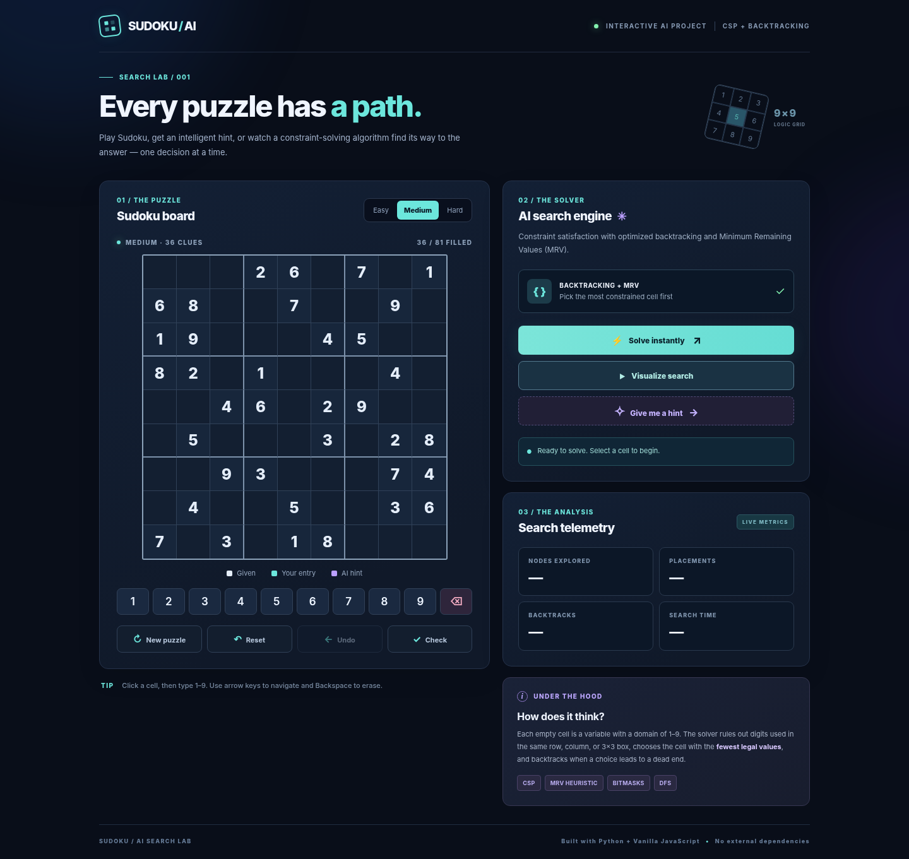

# Sudoku AI Search Lab

A playable Sudoku web app powered by a **Python constraint-satisfaction (CSP) solver**. The project demonstrates **backtracking**, **depth-first search**, **Minimum Remaining Values (MRV)**, and **bitmask-based constraint checking** with an interactive search visualizer.

## Preview



Mobile screenshot: [`screenshots/mobile.png`](screenshots/mobile.png).

## Requirements

- **Python 3.10+** (Python 3.11–3.13 supported)
- A modern web browser
- **No external Python or JavaScript packages**

## Run locally

```bash
cd sudoku-ai-solver
python app.py
```

Open **http://127.0.0.1:8000** in a browser. If that port is busy, run `python app.py --port 8080` and visit port 8080 instead.

> Use the Python server instead of opening `static/index.html` directly. The frontend needs `/api/*` routes to request puzzles and solve boards.

## Features

- Complete 9×9 playable board with row/column/3×3 input conflict highlighting
- Easy, medium, and hard *uniquely solvable* puzzle generation
- **Solve instantly:** fill the board using Python backtracking + MRV
- **Visualize search:** see placements (green) and backtracks (pink), with adjustable playback speed
- **Hint:** complete a selected empty cell, otherwise pick the most constrained empty cell
- **Check:** confirm the board follows the rules and has at least one completion
- Reset, undo, erase, mouse/touch numeric keypad, keyboard number and arrow controls
- Search telemetry: nodes visited, placements, backtracks, time in milliseconds
- Accessible labels, responsive design, no accounts, no paid services

## Project layout

```text
sudoku-ai-solver/
├── .gitignore         # Ignore local Python and editor files
├── app.py             # Threaded HTTP server and JSON REST API
├── solver.py          # Backtracking CSP engine, MRV, bitmasks, trace
├── puzzles.py         # Unique puzzle generator with difficulty levels
├── static/
│   ├── index.html     # User interface
│   ├── styles.css     # Responsive visual design
│   └── app.js         # Board interaction, API calls, playback
├── tests/
│   └── test_solver.py # Unit and end-to-end API tests
├── screenshots/       # Desktop and mobile preview images
└── README.md
```

## How the AI search algorithm works

1. **Variables:** each empty cell is an unknown with possible values from 1–9.
2. **Constraints:** a value may not repeat in its row, column, or 3×3 box.
3. **Efficient constraint lookup:** each row/column/box uses a 9-bit integer, where bit `0` corresponds to digit 1. The set of candidates is `FULL_MASK & ~(row_mask | col_mask | box_mask)`.
4. **MRV heuristic:** choose the empty cell with the **fewest** legal candidates. A cell with zero candidates immediately reveals a dead end.
5. **DFS backtracking:** try a legal digit and recurse. If the branch fails, erase the digit and try the next candidate. The first complete valid board is returned.
6. **Trace:** placement and backtrack events are recorded for replay in the browser. The trace is capped at 12,000 events for UI performance, but the solver always completes the search.
7. **Uniqueness for puzzle generation:** generate a fully solved Sudoku, remove one digit at a time, and retain the removal only when **exactly one** solution remains (count solutions until 2).

**Time complexity:** Backtracking can require exponential search in the number of empty cells in the worst case (coarsely `O(9^E)` for `E` empty cells). MRV and bitmasks greatly reduce typical work. **Auxiliary search space:** `O(E)` recursion depth, in addition to the board and optional event trace.

**Why this qualifies as AI:** CSP/constraint search is a classical symbolic AI technique, not machine learning. The system reasons over constraints and explores a search tree; there is no trained neural network or LLM.

## API

All API responses are JSON.

| Method | Endpoint | Description |
|---|---|---|
| `GET` | `/api/puzzle?difficulty=medium` | Generate a fresh unique Sudoku |
| `POST` | `/api/solve` | Solve board; optionally return visual trace |
| `POST` | `/api/hint` | Return row, column, digit for one empty cell |
| `POST` | `/api/check` | Validate current board and whether a solution exists |

Example `POST /api/solve` request:

```json
{
  "board": [[0,0,0,2,6,0,7,0,1],[6,8,0,0,7,0,0,9,0],[1,9,0,0,0,4,5,0,0],[8,2,0,1,0,0,0,4,0],[0,0,4,6,0,2,9,0,0],[0,5,0,0,0,3,0,2,8],[0,0,9,3,0,0,0,7,4],[0,4,0,0,5,0,0,3,6],[7,0,3,0,1,8,0,0,0]],
  "trace": true
}
```

Example response fields:

```json
{
  "solved": true,
  "solution": "9x9 array of solved digits",
  "solution_count": 1,
  "stats": {"nodes": 46, "placements": 45, "backtracks": 0, "elapsed_ms": 0.1, "trace_capped": false},
  "trace": [{"type": "place", "row": 0, "col": 0, "value": 4, "depth": 0}]
}
```

These response figures are illustrative; your results may differ with the puzzle.

## Tests

Run all tests with the built-in `unittest` module:

```bash
python -m unittest discover -s tests -v
```

Tests cover validity, known solutions, no-solution detection, solution uniqueness, puzzle generation, and server endpoints.

## Possible enhancements

- Pencil notes and advanced logical techniques (hidden singles, locked candidates)
- Uniqueness verification for user-entered custom puzzles
- Saved games and achievements
- Search-tree visualization or comparison of naive DFS vs MRV

## Academic project summary

**Title:** AI Sudoku Solver using Backtracking and Constraint Satisfaction

**Problem:** Solve Sudoku automatically under row/column/box constraints.

**Approach:** Symbolic AI; encode Sudoku as a CSP, use bitmask constraint checking, MRV variable ordering, and recursive depth-first backtracking.

**Input:** A 9×9 grid where zero represents a blank cell.

**Output:** Solved grid and algorithm performance statistics, with an optional visual trace of each choice and backtrack.

**Tech stack:** Python standard library + HTML/CSS/JavaScript.

**Deployment:** Local Python HTTP server. For public deployment, use a production WSGI/ASGI application server or proxy and add request limits/authentication as needed; the provided server is for local use and demonstrations.
